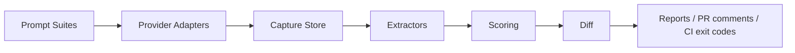

# AnswerCI

> Visibility regression testing for AI answer engines.

[](https://github.com/DivitMittal/answerci/actions/workflows/ci.yml) [](https://github.com/DivitMittal/answerci/actions/workflows/flake-check.yml) [](https://github.com/DivitMittal/answerci/actions/workflows/answerci-visibility.yml)  

AnswerCI is a CLI-first, CI-native toolkit for testing whether README and documentation changes improve or damage how AI answer engines mention, cite, rank, or misrepresent a project. The MVP is offline-first: manual JSONL imports and mock providers keep local runs and CI deterministic, and the OpenAI provider is intentionally a non-networking stub.



## Installation

Enter the Nix development shell when you want the repository's pinned tooling and pre-commit setup:

```bash
nix develop
cargo build -p answerci-cli
```

Run the CLI from source inside the flake-provided development environment:

```bash
nix develop -c cargo run -p answerci-cli -- --help
nix develop -c cargo run -p answerci-cli -- run \
  --suite examples/prompt-suites/oss-project.yaml \
  --providers manual:examples/manual-imports/sample-run.jsonl \
  --run-id sample
```

The current flake exposes the default development shell plus the `render-workflows` package used for generated workflow files; it does not expose an `answerci` app, so `nix run .#answerci` is not available yet.

Install the CLI binary from the workspace when you want an `answerci` command on your `PATH`:

```bash
cargo install --path crates/answerci-cli
answerci --help
```

## Quickstart

```bash
answerci init .answerci-demo

answerci run \
  --suite examples/prompt-suites/oss-project.yaml \
  --providers manual:examples/manual-imports/sample-run.jsonl \
  --store .answerci/runs.db \
  --run-id sample

answerci report \
  --suite examples/prompt-suites/oss-project.yaml \
  --store .answerci/runs.db \
  --run sample \
  --format markdown \
  --output examples/reports/sample-report.md
```

From source without installing the binary:

```bash
cargo run -p answerci-cli -- run \
  --suite examples/prompt-suites/oss-project.yaml \
  --providers manual:examples/manual-imports/sample-run.jsonl \
  --run-id sample
```

## Commands

| Command | What it does |
| --- | --- |
| `answerci init [path]` | Creates `prompt-suites/`, `manual-imports/`, and `reports/` directories under `path` or the current directory. |
| `answerci suite new <name> [--output <path>]` | Prints or writes a starter prompt suite for the named target project. |
| `answerci scan-github <owner/repo> [--root <path>] [--output <path>]` | Generates a starter suite from local `README.md` and `docs/` Markdown in a GitHub-style checkout without calling GitHub. |
| `answerci run --suite <path> --providers <specs> [--store <path>] [--run-id <id>] [--export-jsonl <path>]` | Imports offline provider responses, extracts observations, stores them in SQLite, and prints `RUN_ID=<id>`. |
| `answerci diff --suite <path> --baseline <id> --candidate <id> [--store <path>]` | Scores two stored runs and prints the signed regression delta as JSON. |
| `answerci report --suite <path> (--run <id> \| --candidate <id>) [--baseline <id>] [--format markdown] [--store <path>] [--output <path>]` | Renders a Markdown report for one run or a baseline-vs-candidate comparison. |
| `answerci ci --suite <path> --baseline <id> --candidate <id> --fail-on citation-regression [--store <path>]` | Exits non-zero when the candidate citation rate is lower than the baseline citation rate. |

## CI integration

Use stored baseline and candidate runs to gate pull requests on citation regressions:

```yaml
name: AnswerCI visibility

on:
  pull_request:
    paths:
      - README.md
      - docs/**
      - examples/prompt-suites/**
      - examples/manual-imports/**

jobs:
  visibility:
    runs-on: ubuntu-latest
    steps:
      - uses: actions/checkout@v4
      - uses: dtolnay/rust-toolchain@stable
      - run: cargo install --path crates/answerci-cli
      - name: Import baseline and candidate fixture runs
        run: |
          answerci run \
            --suite examples/prompt-suites/oss-project.yaml \
            --providers manual:examples/manual-imports/sample-run.jsonl \
            --run-id baseline
          answerci run \
            --suite examples/prompt-suites/oss-project.yaml \
            --providers manual:examples/manual-imports/sample-run.jsonl \
            --run-id candidate
      - name: Fail on citation regression
        run: |
          answerci ci \
            --suite examples/prompt-suites/oss-project.yaml \
            --baseline baseline \
            --candidate candidate \
            --fail-on citation-regression
```

To bootstrap a suite without live provider or GitHub API calls, run `answerci scan-github <owner/repo> --root . --output .answerci/prompt-suites/<repo>.yaml` from a local checkout or documentation mirror.

## Prompt suite example

See [`examples/prompt-suites/oss-project.yaml`](examples/prompt-suites/oss-project.yaml) for a suite targeting `DivitMittal/OS-nixCfg` with competitor entities `Misterio77/nix-starter-configs` and `nix-community/home-manager`.

## Metrics

| Metric | What it tracks |
| --- | --- |
| `visibility_rate` | Share of answers that mention the target. |
| `citation_rate` | Share of answers that cite a target URL or repository. |
| `rank_weighted_visibility` | Whether the target appears early in entity ordering. |
| `competitor_share_of_voice` | Share of target-vs-competitor mentions won by competitors. |
| `hallucination_rate` | Placeholder unsupported-claim heuristic rate. |
| `regression_delta` | Candidate score minus baseline score. |

Full formulas are in [`docs/metrics.md`](docs/metrics.md).

## Documentation

- [`docs/architecture.md`](docs/architecture.md) explains the pipeline and crate responsibilities.
- [`docs/metrics.md`](docs/metrics.md) defines the scoring formulas.
- [`docs/ci-mode.md`](docs/ci-mode.md) describes baseline-vs-candidate CI gating.
- [`docs/github-mode.md`](docs/github-mode.md) documents the offline local repository scanner.
- [`docs/provider-adapters.md`](docs/provider-adapters.md) covers manual imports, mock providers, and the OpenAI stub.
- [`docs/ethics.md`](docs/ethics.md) states the measurement-first usage principles.

## MVP done

- Rust workspace with core domain types, serde, and JSON schemas.
- Manual JSONL provider and mock provider.
- Informative OpenAI stub with no accidental network calls.
- SQLite capture store and JSONL observation export.
- Mention and citation extraction heuristics.
- Visibility, citation, rank, competitor, hallucination, and delta scoring.
- Markdown reports and CI citation-regression exit code.
- Offline GitHub repository scanner for local README/docs.

## Strong v1 planned

- Competitor tracking dashboards.
- Playwright-based answer capture.
- PR comments with inline regression summaries.
- HTML report output.
- DuckDB export for analytics.
- Richer claim verification and repeated-run confidence intervals.
