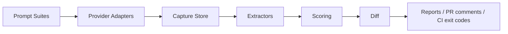

# AnswerCI

> Visibility regression testing for AI answer engines.

[](https://github.com/DivitMittal/answerci/actions/workflows/ci.yml) [](https://github.com/DivitMittal/answerci/actions/workflows/flake-check.yml) [](https://github.com/DivitMittal/answerci/actions/workflows/answerci-visibility.yml)  

AnswerCI is a CLI-first, CI-native toolkit for testing whether README and documentation changes improve or damage how AI answer engines mention, cite, rank, or misrepresent a project.



## Quickstart

```bash
cargo build

answerci init .answerci-demo

answerci run \
  --suite examples/prompt-suites/oss-project.yaml \
  --providers manual:examples/manual-imports/sample-run.jsonl \
  --store .answerci/runs.db \
  --run-id sample

answerci report \
  --suite examples/prompt-suites/oss-project.yaml \
  --store .answerci/runs.db \
  --run sample \
  --format markdown \
  --output examples/reports/sample-report.md
```

From source without installing the binary:

```bash
cargo run -p answerci-cli -- run \
  --suite examples/prompt-suites/oss-project.yaml \
  --providers manual:examples/manual-imports/sample-run.jsonl \
  --run-id sample
```

## Prompt suite example

See [`examples/prompt-suites/oss-project.yaml`](examples/prompt-suites/oss-project.yaml) for a suite targeting `DivitMittal/OS-nixCfg` with competitor entities `Misterio77/nix-starter-configs` and `nix-community/home-manager`.

## Metrics

| Metric | What it tracks |
| --- | --- |
| `visibility_rate` | Share of answers that mention the target. |
| `citation_rate` | Share of answers that cite a target URL or repository. |
| `rank_weighted_visibility` | Whether the target appears early in entity ordering. |
| `competitor_share_of_voice` | Share of target-vs-competitor mentions won by competitors. |
| `hallucination_rate` | Placeholder unsupported-claim heuristic rate. |
| `regression_delta` | Candidate score minus baseline score. |

Full formulas are in [`docs/metrics.md`](docs/metrics.md).

## MVP done

- Rust workspace with core domain types, serde, and JSON schemas.
- Manual JSONL provider and mock provider.
- Informative OpenAI stub with no accidental network calls.
- SQLite capture store and JSONL observation export.
- Mention and citation extraction heuristics.
- Visibility, citation, rank, competitor, hallucination, and delta scoring.
- Markdown reports and CI citation-regression exit code.
- Offline GitHub repository scanner for local README/docs.

## Strong v1 planned

- Competitor tracking dashboards.
- Playwright-based answer capture.
- PR comments with inline regression summaries.
- HTML report output.
- DuckDB export for analytics.
- Richer claim verification and repeated-run confidence intervals.
