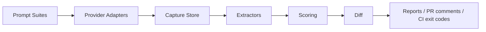

# Architecture

AnswerCI is CLI-first and CI-native. It treats answer-engine visibility as a repeatable regression-testing pipeline instead of a one-off marketing check.

## Components

- **Prompt suites** define the target entity, competitor entities, aliases, citation domains, and repeatable prompts.
- **Provider adapters** capture raw answer-engine responses. The MVP ships manual JSONL imports for deterministic CI and a stub OpenAI adapter that fails with an informative message until live capture is implemented.
- **Capture store** persists runs, raw responses, and extracted observations in SQLite using bundled `rusqlite`, then exports raw observation bundles as JSONL.
- **Extractors** identify mentions, citations, and placeholder unsupported-claim signals.
- **Scoring** converts observations into visibility, citation, rank, competitor, and hallucination metrics.
- **Diff and reports** compare baseline and candidate runs and make regressions visible in Markdown or CI exit codes.
